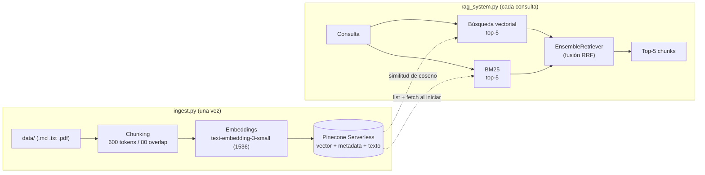

# Sistema RAG escalable con Pinecone (recuperación híbrida)

Módulo de recuperación para un sistema RAG en la nube:

1. **Ingesta** de documentos a un índice **Pinecone Serverless**, con metadata avanzada y el texto original guardado junto al vector.
2. **Recuperador híbrido** (`RAGSystem`): combina búsqueda semántica (vectores en Pinecone) con búsqueda léxica (**BM25**) mediante un `EnsembleRetriever`.
3. **Evaluación** (`evaluate.py`): calcula **Precision@5** y **Recall@5** sobre un *golden set* de preguntas con documento esperado conocido.

## Arquitectura



## Estructura del proyecto

```
ejercicio-4-rag-pinecone/
├── data/                    # Dataset: documentación de "Tasklet" (7 docs .md)
│   ├── guias/
│   ├── referencia/
│   └── errores/
├── golden_set.json          # 5 preguntas con su documento esperado
├── config.py                # Variables de entorno y constantes (validadas)
├── pinecone_setup.py        # Crea el índice Serverless si no existe
├── ingest.py                # Pipeline de ingesta: carga, chunking, embeddings, upsert
├── rag_system.py            # Clase RAGSystem (EnsembleRetriever BM25 + vectorial)
├── evaluate.py              # Precision@k y Recall@k sobre el golden set
├── main.py                  # Demo: top-5 chunks de una consulta
├── requirements.txt
├── .env.example
└── README.md
```

## Cómo replicar el índice de Pinecone

### Requisitos previos

- Cuenta en [Pinecone](https://www.pinecone.io/) (el plan gratuito **Starter** alcanza) y una API key.
- API key de OpenAI (se usa para los embeddings).
- Python 3.12.

> Los embeddings siempre se generan con OpenAI (`text-embedding-3-small`): Anthropic no ofrece una API de embeddings. Si se quisiera otro proveedor, hay que cambiar `EMBEDDING_MODEL` y `EMBEDDING_DIMENSION` en `config.py` y usar un índice con esa dimensión.

### Pasos

1. **Entorno virtual e instalación**
   ```bash
   py -3.12 -m venv venv
   venv\Scripts\activate
   pip install -r requirements.txt
   ```

2. **Variables de entorno**: copiá `.env.example` a `.env` y completá:
   ```
   PINECONE_API_KEY=pcsk_...
   OPENAI_API_KEY=sk-...
   INDEX_NAME=ejercicio-4-rag
   ```
   El `.env` está en `.gitignore`: nunca se sube al repositorio.

3. **Crear el índice** (si ya existe, solo verifica que la dimensión coincida):
   ```bash
   python pinecone_setup.py
   ```

4. **Ingerir los documentos** (carga, chunking, embeddings y upsert):
   ```bash
   python ingest.py
   ```
   Es idempotente: si el namespace ya tiene vectores, la ingesta se omite. Opciones:
   - `--force`: vuelve a subir todo (los ids son determinísticos, así que sobrescribe sin duplicar).
   - `--reset`: borra el namespace y reindexa desde cero (usalo si borraste o renombraste documentos).

5. **Probar el recuperador**:
   ```bash
   python main.py "¿Qué significa el error E4021?"
   python main.py "cómo reintentar una tarea" --category referencia
   ```

6. **Evaluar**:
   ```bash
   python evaluate.py              # recuperador híbrido
   python evaluate.py --compare    # híbrido vs. solo vectorial vs. solo BM25
   ```

### Configuración del índice

| Parámetro | Valor |
|---|---|
| Tipo | Serverless |
| Cloud / región | `aws` / `us-east-1` (el plan Starter solo permite esta región) |
| Dimensión | 1536 (`text-embedding-3-small`) |
| Métrica | `cosine` |
| Namespace | `tasklet-docs` |

El namespace, el cloud y la región se pueden cambiar con `PINECONE_NAMESPACE`, `PINECONE_CLOUD` y `PINECONE_REGION` en el `.env`.

### Esquema de metadata de cada vector

| Campo | Contenido |
|---|---|
| `text` | Texto original del chunk (evita consultar otra base de datos) |
| `source` | Ruta del archivo, ej. `errores/codigos_de_error.md` |
| `doc_id` | Id lógico del documento (nombre del archivo sin extensión); lo usa la evaluación |
| `page` | Número de página (PDF); `1` para Markdown/texto |
| `category` | Categoría (del encabezado del `.md` o, si no hay, nombre de la carpeta) |
| `tags` | Lista de etiquetas (del encabezado del `.md`) |
| `chunk_index`, `chunk_id` | Posición del chunk en el documento e id único (`<doc_id>::c000`) |

Los documentos Markdown pueden llevar un encabezado opcional:

```
---
categoria: errores
tags: errores, diagnostico
---
```

## Diseño

### Recuperador híbrido

- **Vectorial (Pinecone)**: encuentra chunks con el mismo *significado* aunque no compartan palabras ("espera exponencial entre reintentos" → `backoff_factor`).
- **BM25**: puntúa por *palabras exactas*, dando más peso a las poco frecuentes. Es la mejor opción para códigos, nombres propios e identificadores (`E4021`, `run_in_executor`), donde el embedding tiende a diluir el término.
- **`EnsembleRetriever`** fusiona ambos rankings con *Reciprocal Rank Fusion* (pesos 0.5 / 0.5 por defecto, configurables). Cada recuperador trae 5 resultados y la fusión devuelve los 5 mejores. La fusión se hace por `chunk_id`, no por coincidencia de texto.
- **BM25 sin base de datos extra**: como el texto está en la metadata de Pinecone, `RAGSystem` reconstruye el corpus al iniciar (`index.list` + `index.fetch`). Quien clone el repo y replique el índice no necesita ninguna copia local de los documentos.
- **Tokenizador a medida** (`tokenize` en `rag_system.py`): minúsculas, sin acentos, sin *stopwords* en español, y los identificadores `snake_case` se indexan completos y también por partes (`backoff_factor` → `backoff`, `factor`).
- **`LexicalRetriever`**: el `BM25Retriever` estándar siempre devuelve los `k` mejores aunque no compartan ninguna palabra con la consulta. Esta subclase descarta los de puntaje 0 para no contaminar la fusión con resultados arbitrarios.
- **Filtro por metadata**: `rag.retrieve(consulta, category="errores")` restringe tanto la búsqueda vectorial (filtro de Pinecone) como la léxica.

### Cómo se resolvieron los errores comunes de la consigna

- **Mismatch de dimensiones**: `pinecone_setup.py` compara la dimensión de un índice existente con la de los embeddings, y `ingest.py` verifica la dimensión real de los vectores antes de subirlos. En ambos casos falla con un mensaje claro.
- **Ignorar el namespace**: todo se sube y se consulta dentro de un namespace propio (`tasklet-docs`), de modo que otros datos del mismo índice no ensucien la búsqueda.
- **Chunking**: `RecursiveCharacterTextSplitter` midiendo en tokens (600 con 80 de overlap), dentro del rango de ~500-800 tokens que recomienda la consigna.

### Detalles operativos

- Pinecone es *eventualmente consistente*: justo después de subir vectores, las estadísticas, `list` y `fetch` pueden tardar unos segundos en reflejarlos. La ingesta espera (con tope) y `RAGSystem` avisa si el namespace aparece vacío.
- Cada vector admite hasta 40 KB de metadata; con chunks de ~600 tokens hay margen de sobra.
- Un índice recién creado puede rechazar conexiones unos segundos aunque figure como `ready`; `namespace_vector_count` reintenta.

## Evaluación

`evaluate.py` recorre `golden_set.json` (5 preguntas, cada una con `documento_id_esperado`), recupera el top-5 de cada una y calcula:

- **Recall@5**: ¿está el documento correcto entre los 5 recuperados? (con un único documento esperado vale 1 o 0; el reporte promedia las 5 preguntas).
- **Precision@5**: de los 5 chunks recuperados, ¿qué fracción pertenece al documento esperado? Se mide a nivel de chunk.
- **MRR** (extra): promedio de 1/posición del primer acierto. Sirve para distinguir modos cuando el Recall ya llegó a 1.00 en todos.

**Cómo leer Precision@5**: si el documento esperado se partió en pocos chunks (por ejemplo 2), un recuperador perfecto no puede traer más de 2 chunks útiles entre los 5, y su precisión máxima es 2/5 = 0.40. Por eso el reporte muestra, junto a cada valor, la **máxima precisión posible**.

**Limitación a tener en cuenta**: con un corpus tan chico (7 documentos), 5 chunks cubren una parte grande de la colección y el Recall@5 tiende a saturarse en 1.00 para cualquier modo. Para que la comparación sea más exigente: `python evaluate.py --compare --k 3`, o agregar documentos al dataset y más preguntas al golden set.

### Resultados de evaluación

Salida real de `python evaluate.py --compare` (k=5), ejecutada contra un índice Pinecone Serverless (`aws/us-east-1`) con embeddings `text-embedding-3-small`:

```
Modo         Recall@5   Precision@5   Máx. posible     MRR   Aciertos
hybrid           1.00          0.28           0.28    1.00       5/5
vector           1.00          0.28           0.28    0.90       5/5
bm25             1.00          0.20           0.28    1.00       5/5
```

Detalle del recuperador híbrido por pregunta (todas con el documento esperado en el puesto #1):

| Pregunta (tema) | Recall@5 | Precision@5 | Máx. posible |
|---|---|---|---|
| Error E4021 | 1.00 | 0.40 | 0.40 |
| Factor de backoff exponencial | 1.00 | 0.40 | 0.40 |
| Ejecutar cada 5 minutos (cron) | 1.00 | 0.20 | 0.20 |
| Extra para broker Redis | 1.00 | 0.20 | 0.20 |
| Detener un worker sin perder tareas | 1.00 | 0.20 | 0.20 |

**Interpretación**

- **Recall@5 = 1.00 en los tres modos**: el documento correcto aparece siempre entre los 5 primeros. Con un corpus de 7 documentos (~10 chunks) y k=5, este número se satura y no permite distinguir los modos entre sí.
- **Precision@5 = 0.28 en híbrido y vectorial**, que coincide con el máximo posible: el recuperador trajo todos los chunks del documento esperado. El valor es bajo en términos absolutos porque cada documento tiene solo 1 o 2 chunks, de modo que el tope teórico es 0.20–0.40 por pregunta. **BM25 solo (0.20)** quedó por debajo del máximo porque no recuperó todos los chunks relevantes: en preguntas con más de un chunk útil, algunos no comparten palabras exactas con la consulta.
- **MRR muestra la diferencia de ranking**: híbrido y BM25 ponen el documento correcto en el puesto #1 en las 5 preguntas (MRR 1.00), mientras que la búsqueda vectorial sola falla el primer puesto en una pregunta (MRR 0.90). El híbrido conserva la precisión del ranking léxico y la cobertura del semántico.
- **Conclusión honesta**: con un dataset tan chico, las tres variantes funcionan bien y la ventaja del híbrido es pequeña. Para una comparación más exigente conviene correr `python evaluate.py --compare --k 3` o ampliar el corpus y el golden set.

## Dataset

`data/` contiene documentación de **Tasklet**, una librería de Python *ficticia* (cola de tareas asíncronas) escrita para este ejercicio. Para usar la documentación de una librería real: copiá sus archivos `.md`/`.txt`/`.pdf` a `data/` (opcionalmente con el encabezado de categoría y tags), actualizá `golden_set.json` con preguntas y documentos esperados, y corré `python ingest.py --reset`.
